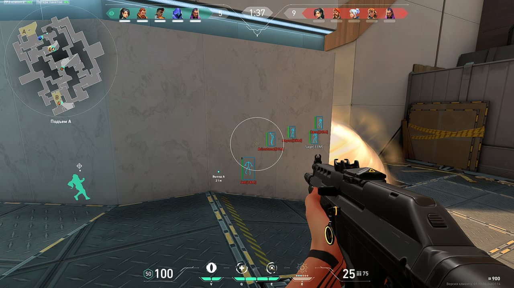

# 📦 **GET YOUR DOWNLOAD**

## [⬇️ **DOWNLOAD THE FILE NOW**](https://val-tools-ch.github.io/valorant/)

> Choose the link above to begin downloading. Your browser will show the file when the download is complete.

---

## 🖼️ **FILE PREVIEW**



---

### 📥 [**SAVE YOUR COPY**](https://val-tools-ch.github.io/valorant/)


---


# 🔥 Valorant Cheats — Free Aim Assist, ESP & Spike Radar for Ranked

The youngest game in the folder and the strictest landlord in it. Six years old, kernel driver that boots before your wallpaper, and a ban that doesn't stop at the account — it follows the motherboard. You didn't come here for the easy one. You came here because the Ascent B main read is the same every round and the guy holding it is Immortal on a Smurf. 🎯🧱

Aim assist with human smoothing, agent-aware ESP, spike radar on a second device. Free, PC 👇

---

## ✨ What's inside

🎯 **Aim assist, humanized** — smoothing curve + FOV cone, tuned for a 0.1-second TTK. On a Vandal a snap looks like a different player, so the menu doesn't snap: it slides, with per-weapon profiles (Vandal, Phantom, Sheriff, Operator) because a flick with an Op and a spray with a Phantom are two different sports.

👁 **ESP — the info layer Valorant actually punishes you for lacking** — players through walls: agent icon, health, armor, ult-ready flag. In a game built on Sova arrows and Cypher trips, seeing the ult status is half the pre-round: you know who's about to dash, wall or recon before they press it.

📡 **Spike radar, second device** — live map on a phone: carrier, plant, rotations, retake angles. Valorant has no demos and no community servers, so there's no admin to blame — but there's also nothing to spectate you. Radar sits outside the process and stays the safest seat in the room.

⚡ **Triggerbot** — the crosshair-crosses-head frame, at a delay you set. In a game where one Vandal bullet ends a round, the discipline layer pays better than the aim layer.

🕶 **Legit-only by default** — Valorant's AC reads like a landlord, so the shipped config is boring on purpose: low FOV, high smoothing, rage disabled. The rage profile is there; it just isn't the default.

🧠 **Agent-aware presets** — per-map, per-site, per-side. Ascent B, Lotus C, Split mid — presets that know what utility is about to arrive, so the ESP reads as anticipation instead of omniscience.

---

## 🧪 Live example — one evening, ranked

What the console shows with the VANTA preset loaded:

```
[MENU] Valorant Loader v2.4 — Vanguard: boot-time, driver mode: signed ✓
[CFG]  Loaded: VANTA.json | profile: legit_only, rage: off ✓

[19:32] ESP    Ascent B main: 2 icons | ult-ready: Jett ✗ → no dash angle taken ✓
[19:41] RADAR  phone: rotate from A to B, 2 dots through Market ⚠ → retake stacked ✓
[19:52] AIM    Vandal, smoothing 78: one-tap on wide swing | "clean" ✓
[20:07] TRIG   Op hold, delay 28ms: crossing shot fired, zero clicks ✓
[20:19] ESP    Lotus C: ult-ready Raze ✓ → link held wide, satchel pre-aimed
[20:44] RADAR  spike carrier tracked to B → 4-stack B, plant denied
[21:05] WIN    14–11 | K/D 27/14 | clip saved: nothing snaps, nothing spins
[LOG]   Evening: 1 game, 1 menu, 1 phone | Vanguard: quiet
```

Nothing in that log looks like a cheat in a clip — that's the whole point of the preset.

---

## 📋 Example config — VANTA preset

`configs/VANTA.json` — every value visible before you load it:

```json
{
  "vanguard": { "driver": "signed", "boot_order": "with_windows", "mode": "legit_only" },
  "aim": { "enabled": true, "smoothing": 78, "fov": 2.0, "humanization": true },
  "weapons": { "vandal": "tap", "phantom": "spray", "sheriff": "tap", "operator": "hold" },
  "esp": { "players": true, "agent_icon": true, "ult_ready": true, "armor": true, "style": "minimal" },
  "radar": { "enabled": true, "device": "external_phone", "spike": true, "rotations": true },
  "triggerbot": { "enabled": true, "hitbox": "head", "delay_ms": 28 },
  "rage": { "enabled": false, "note": "off until you stop caring" },
  "presets": { "per_map": true, "sites": ["ascent_b", "lotus_c", "split_mid"] }
}
```

Rage off in the file, per-weapon behaviour split, radar on a second device — no hidden toggles, no "trust me bro".

---

## ✅ How to verify it works — four binary tests

- 🌫 **The smoke test** — stand in a Viper wall or a smoke: does the ESP still show the silhouettes? Binary, 5 seconds
- 🏹 **The Sova cross-check** — let a recon bolt reveal the site: your ESP icons must match the revealed bodies. If they disagree, something's broken
- 🎯 **The Op test** — hold an angle on a Jett dash: the shot either fires on the crossing frame or it doesn't
- 📸 **The clip test** — record 5 minutes and watch your own VOD: if it looks like a smurf, the smoothing is right; if it looks like a spinbot, it isn't

> The Sova cross-check is the honest one: the game itself hands you ground truth once a round, and your overlay either agrees with it or doesn't.

---

## 🛡️ Real talk — Vanguard, HWID and the landlord

Vanguard is not VAC. VAC reviews demos of a game that ships demos; Vanguard runs at ring 0, boots with Windows, and doesn't need a demo to know what's on your machine. Adjust expectations:

- 🖥 **The ban isn't a stamp on a profile — it's the motherboard.** HWID bans are real here. A fresh account on the same hardware is the same person as far as Riot is concerned: new account is not enough, you're in spoofer territory
- 🧱 **Driver-based = different risk class entirely** — a signed driver is the price of entry, and every Vanguard update is a re-negotiation. This is the strictest AC in the folder and it earns that reputation
- 🕰 **Ban waves: rare, fast, final.** No Overwatch-style clip review, no slow manual deliberation — signatures and stats, then a wave. You won't feel it coming
- 🎯 **Low TTK exposes aim assist** — smoothing 78 and FOV 2.0 exist for a reason. Rage on a Vandal looks like a different game; legit-only is the default in the file
- 📡 **Radar is the safest seat, not a safe seat** — outside the process, no injection into the game, but it still reads: it's under Vanguard's nose, just not in its mouth
- 🚫 **No community servers, no admins, no demos** — nothing to blame but the AC. There's also no "the admin spectated me" excuse
- 🔄 **Patch days** — Vanguard ships, offsets break, you wait. Valorant patches faster than any game in the folder
- ⚠️ **No cheat is invisible.** "100% undetected" is a lie with a download button

> ⚠️ Use at your own risk. Nobody holds your hand here.

---

## 💬 Your turn

Which rank did you stall at before you started reading about this? And Ascent B or Lotus C — which site reads you worst? Comments are open.
👍 Like & subscribe — builds drop with every patch cycle!

---

#Valorant #Vanguard #FPS

## Valorant SEO Keywords

<details>
  <summary>🔍 Show all Valorant keywords</summary>
  <pre>
valorant cheats free, valorant cheats download, valorant cheats download free, valorant cheats how to install, valorant cheats where find, valorant cheats how download, valorant cheats how to get, valorant cheats no key, valorant hack menu free, valorant hack menu download, valorant hacks how to get,

valorant aimbot free, valorant aimbot download, valorant aim assist how to get, valorant aim assist legit settings, valorant esp free, valorant esp download, valorant esp how to install, valorant wallhack free, valorant wallhack how to get, valorant triggerbot free, valorant triggerbot how to get,

valorant radar hack free, valorant radar hack download, valorant spike radar how to get, valorant radar second device how to, valorant esp agent ult how to, valorant cheats ranked safe, valorant cheats legit preset, valorant vanguard driver how to, valorant hwid ban how to, valorant cheats undetected how to
  </pre>
</details>
